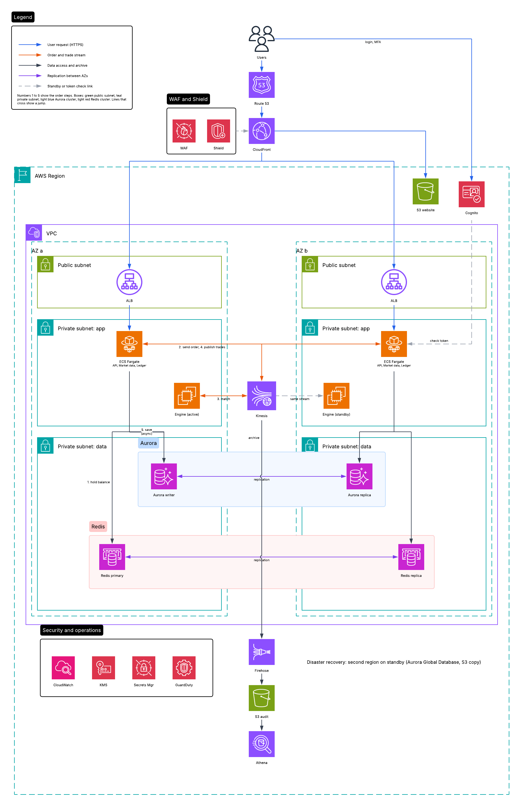

# Problem 1: Building Castle In The Cloud

**Scope:** a spot trading system. Users log in, place and cancel orders, see the live order book and trades, and see their balance.

**Targets:** 500 requests per second, and p99 response time under 100 ms.

## 1. Overview diagram

How to read it:
- Users come in through Route 53 and CloudFront (with WAF and Shield). The website files are in S3. API calls go to the ALB in a public subnet of each AZ.
- Login and MFA are done by Cognito. The API service checks the token.
- The services run on ECS Fargate in private subnets. Redis, Kinesis and the matching engine are in private subnets too. Aurora is in the private data subnets.
- Aurora (writer in AZ a, replica in AZ b) and Redis (primary and replica) are each drawn as one group box, with a replication arrow between the two AZs.
- Every order is also archived: Kinesis to Firehose to S3 (audit) to Athena.
- CloudWatch, KMS, Secrets Manager and GuardDuty cover monitoring and basic protection.
- Only two AZs are drawn. AZ c is the same as AZ a and AZ b (the stream and the services use 3 AZs).
- Disaster recovery: a second region on standby (Aurora Global Database, S3 copy).

**How an order flows (fast, under 100 ms).** The numbers match the arrows in the diagram:
1. The API service checks the login token, limits requests, and holds the balance in Redis.
2. It writes the order to the Kinesis `orders` stream (one partition per symbol, so the order stays correct) and replies "accepted".
3. The matching engine reads the stream, matches orders in memory, and writes trades to the `trades` stream.
4. The market-data service reads the trades and pushes the order book and trades to users with WebSocket.
5. The ledger service saves the result in Aurora later (async).

The database is not in the fast path. That is how we keep p99 under 100 ms.

## 2. Why each service, and other choices

| Service | What it does | Why we use it | Other choices |
|---|---|---|---|
| Route 53, CloudFront, WAF, Shield | DNS, fast delivery, filter bad traffic, DDoS protection | Trading sites are DDoS targets. CloudFront makes the website fast. | Cloudflare (good, but we must use only AWS) |
| S3 | Stores the website files | Cheap and no servers | Amplify Hosting (more than we need) |
| ALB | Entry for REST and WebSocket, spreads traffic over AZs | Supports WebSocket and health checks | API Gateway (slower, more cost), NLB (no HTTP routing) |
| Cognito | Login, MFA, tokens | Managed and safe. We do not build login ourselves. | Keycloak (more control, more work to run) |
| ECS Fargate | Runs our services | No servers to patch, autoscaling, simple | EKS (more power, more work), EC2 (cheaper at large size, more work) |
| Kinesis Data Streams | Ordered log of orders and trades that we can replay | Keeps order per symbol. A standby can rebuild the order book by replaying it. Fully managed. | MSK/Kafka (faster, but more to run), SQS FIFO (no replay) |
| EC2 matching engine | Keeps the order book in memory and matches orders | Needs steady speed and one writer per market | Lambda or Fargate (can be slow to start), database matching (too slow) |
| ElastiCache Redis | Fast reads for balances, limits, order book copy | Under 1 ms | MemoryDB (saves data, costs more) |
| Aurora PostgreSQL | The source of truth: ledger, orders, trades | Safe transactions for money, fails over in about 30 seconds | DynamoDB (scales more, harder for a ledger) |
| Firehose, S3, Athena | Audit trail and reports | Cheap, lasts long, easy to query | OpenSearch (better search, costs more) |
| CloudWatch, X-Ray | Metrics, logs, alarms | Built in and cheap | Datadog (richer, costs more) |
| KMS, Secrets Manager, GuardDuty | Keys, passwords, threat detection | Basic protection for money systems | Self-managed secrets (more risk) |

## 3. Staying available

- Every part runs in at least 2 AZs (3 for the stream). If one AZ fails, traffic moves by itself.
- Services sit behind the ALB with health checks and autoscale.
- The matching engine has an active copy and a standby. Both read the same stream. If the active one fails, the standby takes over in seconds, and no order is lost because the stream is the record.
- Aurora and Redis fail over by themselves.
- Disaster recovery: a second region with Aurora Global Database and S3 copy. It is a small standby, so it costs less, and recovery takes minutes.
- Releases are rolling, with automatic rollback.

## 4. Speed

- The API answers after a fast, safe write to the stream. It does not wait for matching or the database.
- Balance checks use Redis. The database is updated later.
- 500 requests per second is small, so we have a lot of room. A load test with a p99 alarm checks this before each release.

## 5. Scaling plan

| When we grow | What we do |
|---|---|
| 5x to 10x more traffic | More Fargate tasks. More Kinesis shards (on-demand does it for us). More Aurora and Redis read replicas. |
| More trading pairs | One matching engine pair per group of symbols. Busy symbols get their own engine. |
| Very high order rate | Move the stream to MSK (Kafka) for more speed. Split the ledger database into parts (sharding or Aurora Limitless). |
| Users around the world | Add regional read endpoints and market-data services. Keep one region as the place where matching happens. |
| Lower cost | Savings Plans for the engine servers, Graviton instances, move old data from Aurora to S3 and query it with Athena. |

## 6. Cost

At 500 requests per second the base setup is small: a few Fargate tasks, one on-demand stream, one Aurora cluster with one replica, and a small Redis. The matching engine servers and their standby are the main fixed cost. The rest grows with use.

## 7. Assumptions and what we left out

- Only spot trading. Futures, margin, staking and fiat payments are out of scope.
- No wallets or blockchain connection. Balances live in our own ledger.
- KYC, AML and reports are covered only by the audit trail.
- Server sizes and costs need a load test. This is a paper design.
