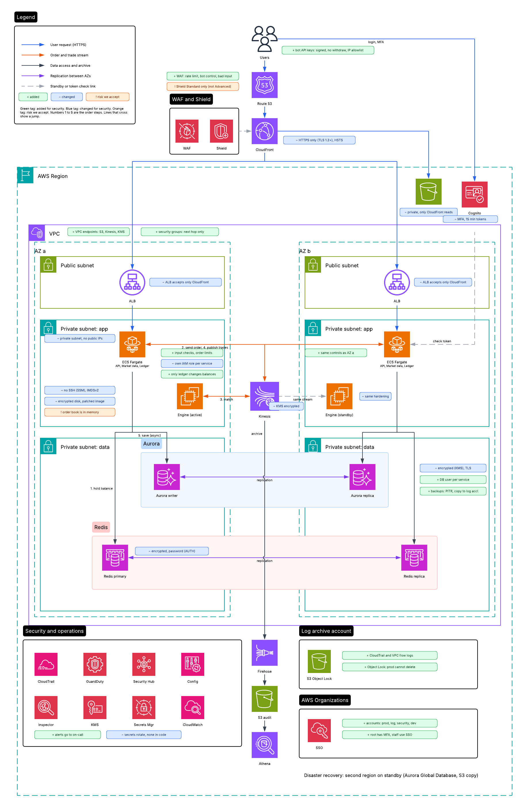

# Problem 5: Fortify The Castle

We start from the Problem 1 design. Security is built into each part, not added at the end.

## 1. Updated architecture

The picture is the Problem 1 design with the security parts marked:
- **Green tag (+):** added for security.
- **Blue tag (~):** changed for security.
- **Orange tag (!):** a risk we accept (Shield Standard only, and the order book in memory on the engine server).

Where to look:
- **Edge:** CloudFront with HTTPS only and HSTS, WAF rate limits and bot control, the S3 website readable only by CloudFront, and the ALB accepting only CloudFront. Nobody can skip the WAF.
- **Login:** Cognito with MFA and 15 minute tokens. Bot API keys are signed, cannot withdraw, and are limited to allowed IPs.
- **Network:** private subnets with no public IPs, security groups where each part talks only to the next part, and VPC endpoints so traffic to S3, Kinesis and KMS stays off the internet.
- **Services:** each service has its own IAM role, and only the ledger service changes balances.
- **Data:** Redis, Kinesis and Aurora are encrypted. Aurora has one database user per service, and its backups are copied to another account.
- **Engine:** no SSH (use SSM), IMDSv2, encrypted disk, patched image.
- **Operations:** CloudTrail, GuardDuty, Security Hub, Config and Inspector send alerts to on-call. Secrets Manager rotates passwords.
- **Accounts:** prod, log, security and dev accounts in AWS Organizations. Logs go to a separate account with S3 Object Lock. Root has MFA and staff use SSO.

## 2. Why each change is there

| Change | What it protects against |
|---|---|
| WAF rules and rate limits | Bots, brute force, DDoS at the application level, bad input |
| HTTPS only, HSTS | Someone reading or changing traffic on the network |
| ALB accepts only CloudFront; S3 private | Attackers skipping the WAF and calling the ALB or S3 directly |
| MFA and short tokens | Stolen passwords and stolen tokens (account takeover) |
| Bot API keys: signed, no withdraw, IP allowlist | A leaked key being used to steal money |
| Private subnets, security groups, VPC endpoints | An attacker moving between parts, or reaching data from the internet |
| One IAM role per service, least access | One hacked service reading or changing everything |
| Only the ledger service changes balances | A bug or a hacked API service creating money or changing balances |
| Separate DB user per service | The same as above, at the database level |
| Order checks: input, limits, idempotency keys | Bad orders, duplicate orders, one user flooding the engine |
| Encryption at rest (KMS) and in transit (TLS) | Stolen disks or backups, someone listening inside the network |
| Secrets Manager with rotation | Passwords in code, old passwords that live forever |
| No SSH, IMDSv2, patched image on the engine servers | Break-in through a login or a server-side request attack |
| CloudTrail, flow logs in a separate locked account | An attacker deleting their traces. Also needed for investigations. |
| GuardDuty, Security Hub, Config, Inspector, alarms | Attacks we do not see. Settings that drift. Old software with known bugs. |
| Backups copied to another account | Ransomware or a deleted database |
| Separate AWS accounts, root MFA, SSO | One stolen key giving access to everything |

## 3. Priorities

**We refuse to ship without these:**
- HTTPS everywhere, and encryption at rest.
- MFA for users.
- WAF and rate limits.
- Private subnets and least-access IAM roles.
- No secrets in code (Secrets Manager).
- Only the ledger service can change balances.
- CloudTrail in a separate locked account.
- Backups, with a tested restore.
- Separate prod account, and MFA on root.
- An independent penetration test before real money is used.

**We do first (right after the base is running):**
- Alerts for strange logins, many failed logins, big order spikes, and big balance changes.
- Image and package scanning in CI, and signed images (see Problem 4).
- A short incident runbook: who is called, how to isolate a service, how to restore.

**We defer (later):**
- Shield Advanced, because it costs a lot. Shield Standard and WAF are enough to start.
- AWS Network Firewall to filter outgoing traffic.
- CloudHSM for key signing.
- DNSSEC for Route 53.
- A SIEM and a 24/7 security team, SOC 2 or ISO 27001, a bug bounty, and fraud detection with machine learning.

## 4. Risks we accept

- **Shield Standard only.** A large DDoS could still cause trouble. We accept it at the start, and we use WAF rate limits and CloudFront to reduce it.
- **Redis balances can be a little out of date.** The ledger in Aurora is the truth and checks every change. We accept it for speed.
- **The order book is in memory on the engine server.** If an attacker gets into that server, they can read it. We reduce it with no SSH, hardening, and a small set of people with access. We cannot remove it without making the engine slower.
- **Third-party libraries.** There is always some risk. We scan them, but we cannot check all of them.

## 5. Facts we do not have

We do not know these yet. For now we assume the answers below, and we would ask the person in brackets.

- **Which laws apply** (KYC, AML, data protection) [legal]. We assume we keep an audit trail for 7 years, store little personal data, and keep KYC documents at a third-party provider.
- **Do we hold customer crypto?** [product owner]. We assume no. Withdrawals are a separate system.
- **Who may attack us** [security team]. We assume common internet attacks, account takeover, and one insider.
- **How fast we must recover** [business]. We assume the ledger loses no data and recovery takes about 15 minutes.
- **Budget and team size** [finance and manager]. We assume both are small, so we use managed AWS services and simple alerts.

## 6. What we left out

- **Withdrawals and wallet security.** This is the most dangerous part, but it is a different system.
- **Full compliance work** (SOC 2, PCI, reports). Logs and access control make it possible, but we do not do the paperwork.
- **The "defer" list in section 3.** It saves cost and time, but some risk stays until we add it.
- **Encryption of every database field.** We encrypt the disk and the connection and limit who can read data. This is simpler and faster.
- **Calling Cognito on every request.** We check tokens locally to keep p99 under 100 ms.
- **Multi-region active/active security.** It is too much for a first version. Disaster recovery uses a standby region.
